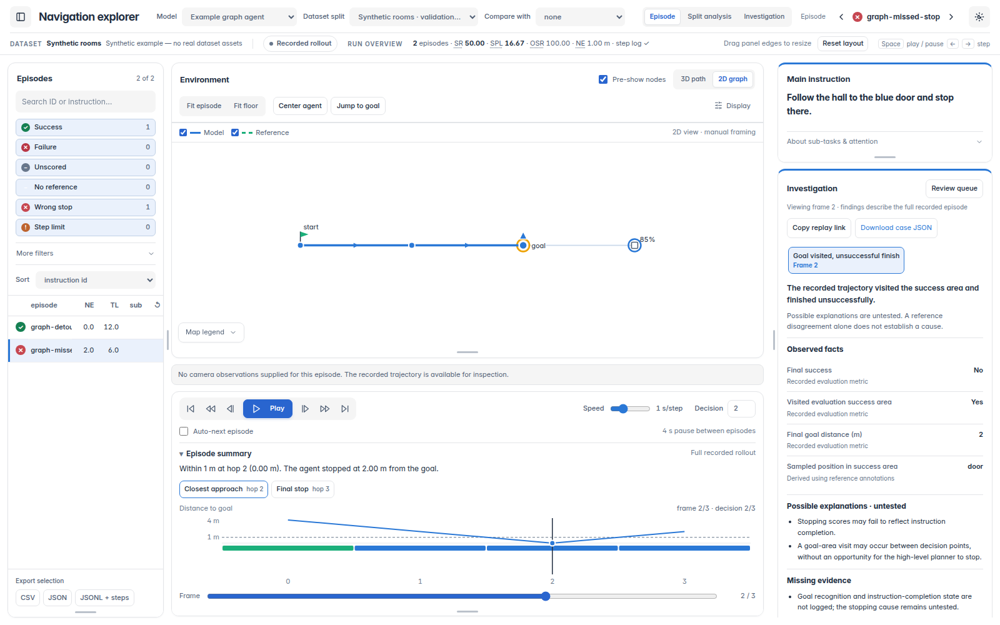

# Navigation Explorer

**Watch your navigation agents move, step by step.** Navigation Explorer is a
browser application for replaying recorded navigation in **2D and 3D**. Follow an
agent's route, scrub through its actions, compare its path with a reference or
another model, and inspect camera panoramas and building geometry when available.

Use the same viewer for **discrete graph navigation (non-CE)**,
**continuous navigation (CE)**, and recordings from your own models and datasets.
Investigation tools help you and your AI agents connect unusual behavior to the
exact replay frames and recorded evidence.



*The running application with the bundled synthetic demo. Real experiments can
also show camera panoramas and 3D buildings when you supply the corresponding assets.*

The explorer reads saved experiments. Its core needs **Python 3.10+ and a browser**;
it does not require a GPU, Habitat, MatterSim, model weights, Node.js, or a frontend
build. Fonts, icons, and Three.js are included locally.

## Try it

Clone and install, preferably in a virtual environment:

```bash
git clone https://github.com/davemaxuell/CVPR-2027-Navigation-Explorer.git
cd CVPR-2027-Navigation-Explorer
python -m pip install .
navigation-explorer --demo --open-browser
```

Open **http://127.0.0.1:8765/**. The bundled demo contains synthetic discrete,
continuous, and unscored recordings. It needs no dataset downloads. If the port
is occupied, add `--port 8766`; `--port 0` selects an available port.

For development, use `python -m pip install -e .`. The equivalent module command
is `python -m navigation_explorer --demo`.

## See the navigation

- **Replay an episode:** play, pause, step, and scrub the timeline while the map
  follows the agent. Keep the instruction and distance-to-goal history in view.
- **Explore the scene:** switch between a 2D navigation graph and a 3D route;
  add building meshes and camera panoramas for a richer view of the environment.
- **Compare routes:** overlay the recorded path, reference path, and a compatible
  model's path to see where they diverge.
- **Inspect a decision:** review the chosen action and recorded scores at a
  particular step, with reference comparisons where the adapter supports them.
- **Find episodes to review:** browse split summaries, filter outcomes, and save
  tags and notes. The Investigation queue flags goal visits followed by failure,
  low displacement, waypoint misses, backtracking, and inefficient successes.
- **Share evidence with AI agents:** export case JSON with replay links, frame
  anchors, observations, hypotheses, evidence gaps, and suggested next tests.

In the demo, open `graph-missed-stop`, press **Play**, and watch the agent reach
the goal and continue past it. Open **Investigation** to jump back to the relevant
frame. Switch the model selector to the continuous example to inspect a waypoint
execution mismatch. The [asset guide](docs/assets.md) explains how to add camera
views and building geometry to your own experiments.

Signals are deterministic review heuristics. They do not establish a failure's
cause. Missing scores, evaluation metrics, camera images, and STOP actions remain
missing instead of being inferred from an arbitrary model or benchmark.

## Load your experiments

Create a project JSON file. Paths resolve relative to that file, so the project
works from any current working directory. Each run names its model, dataset,
split, environment, and adapter explicitly.

```json
{
  "schema_version": "navigation-explorer/project-v1",
  "name": "My navigation experiment",
  "runs": [{
    "id": "my-agent/validation",
    "adapter": "recording",
    "model": "My agent",
    "dataset": "My indoor dataset",
    "split": "validation",
    "environment": "continuous",
    "episodes": "recordings/validation.jsonl"
  }]
}
```

```bash
navigation-explorer --project project.json --check
navigation-explorer --project project.json --open-browser
```

| Your input | Adapter | Required inputs |
| --- | --- | --- |
| Any model, custom dataset, graph or continuous trajectory | `recording` | Portable episode JSON/JSONL; positions in meters with z up |
| R2R-style or DUET/ScaleVLN predictions | `r2r` | Predictions, annotations, connectivity; optional step logs and scene assets |
| Native ETPNav explorer logs | `etpnav` | Episode JSONL and connectivity; optional annotations, panoramas, and scene assets |

CE-only projects are supported. An arbitrary CE model does not need to imitate
ETPNav: export the common recording format instead. Raw checkpoints and arbitrary
training-log formats are not loaded automatically.

Start with [exporting another model](docs/recordings.md),
[project configuration](docs/projects.md), or
[native R2R and ETPNav imports](docs/native-adapters.md).

## Export from another model

```python
from navigation_explorer.writer import episode_from_positions, write_recordings

episode = episode_from_positions(
    "trial-001", "room-a", "Walk to the doorway.",
    [(0, 0, 1.5), (1, 0, 1.5), (2, 1, 1.5)],
    termination="unknown",
)
write_recordings("recordings/validation.jsonl", [episode], environment="continuous")
```

This produces an **unscored** replay. Add actual evaluation results and decision
records when available. The exporter validates the records and refuses to replace
an existing file unless `overwrite=True` is supplied. See the
[portable episode schema](schemas/navigation-episode.schema.json) and
[examples](examples/).

## AI-agent access

The browser and your agents use the same local API:

```bash
curl 'http://127.0.0.1:8765/api/meta'
curl 'http://127.0.0.1:8765/api/investigations?run=demo%2Fdiscrete&limit=50'
curl 'http://127.0.0.1:8765/api/investigation?run=demo%2Fdiscrete&id=graph-missed-stop'
```

Case JSON includes evidence references, frame/decision anchors, trace provenance,
notes, and suggested next tests. Remote agents need access to the server or an
exported JSON bundle. See [API reference](docs/api.md).

## Local data and remote use

Datasets stay wherever you keep them. Images, meshes, checkpoints, generated caches,
and personal notes are not part of the repository. Review state defaults to
`~/.local/share/navigation-explorer/projects/<project-key>/` (or `$XDG_DATA_HOME`);
override it with `--state-dir /path/to/reviews`. The installed package is never a
runtime write target. Use one server per state directory.

For a server accessed over SSH:

```bash
# On the server
navigation-explorer --project project.json
# On your laptop
ssh -L 8765:127.0.0.1:8765 user@server
```

The viewer is a local research tool with editable review notes, not an authenticated
multi-user hosting service. It binds to localhost by default.

## Scope and optional features

The common format preserves recorded metrics and their declared distance semantics;
it does not substitute straight-line distances for geodesics. Native adapters retain
their benchmark definitions. Comparison is limited to compatible datasets,
splits, environments, and coordinate systems, unless explicitly aligned in the
manifest.

Building meshes and six-face camera panoramas are optional. Mesh conversion from
supported Matterport PLY assets requires `python -m pip install '.[meshes]'`.
See [assets and provenance](docs/assets.md). Ordinary RGB videos and arbitrary
mesh formats need conversion before they can be used as these optional assets.

Live model inference and GPU what-if branching are not included in this standalone
release: those require a model-specific runner and simulator. The viewer never
starts a suggested experiment merely because a case is opened.

## Development

```bash
python -m pip install -e .
python -m unittest discover -s tests -v
node tests/test_presentation.mjs
node tests/test_portable_presentation.mjs
navigation-explorer --demo --check
```

Node.js is only needed for the frontend helper checks. CI runs the Python and
JavaScript checks on Linux, macOS, and Windows. See [CONTRIBUTING.md](CONTRIBUTING.md)
for adapter responsibilities and the repository structure.

## License

[MIT](LICENSE), retaining the original NavVEM authors' notice.
Bundled fonts, icons, and rendering code retain their
[third-party notices](THIRD_PARTY_NOTICES.md). Dataset and model licenses are
separate; no real dataset assets are redistributed here.
